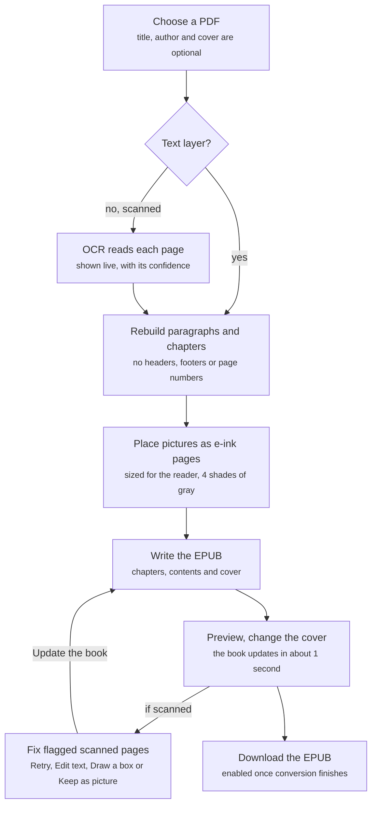
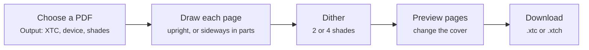

# convertPdf — Business Requirements Document

Date: 2026-10-23 · Product version: v1.3.0

## 1. Executive summary

convertPdf turns any PDF, including scanned books with no text layer, into a clean, readable EPUB e-book that runs entirely on the user's own computer.

PDFs are built for fixed-size printed pages. On a 6-inch e-reader they force zooming and panning, keep running headers and page numbers in the text, and break sentences across pages. Scanned books are worse: they are only pictures of text, so they cannot be reflowed, searched or resized at all.

convertPdf solves this by rebuilding real paragraphs and chapters, reading scanned pages with built-in OCR (English and Indonesian), and keeping pictures as full-screen pages tuned for 4-shade e-ink screens, sized for the chosen Xteink reader (480 x 800 for the X4 and X4 Pro, 528 x 792 for the X3). It ships as a website (https://achmadm23.github.io/convertPdf/), a local web app, a command-line tool and a no-install Windows executable (`ConvertPdf.exe`, about 60 MB zipped). No file is ever uploaded to a server: the website converts inside the visitor's browser.

For Xteink readers (X3, X4 and X4 Pro), it can also make an XTC book: every PDF page drawn ready for the reader's screen, in black and white (`.xtc`) or 4 shades of gray (`.xtch`).

## 2. Business objectives and success criteria

The product succeeds when a non-technical reader can turn a PDF into an e-book that reads like a commercial EPUB, in minutes, without installing anything or sending the file anywhere.

| # | Objective | Success criterion |
| --- | --- | --- |
| BO-1 | Make PDFs readable on e-readers | Output is a reflowable EPUB with real paragraphs, no running headers, footers or page numbers, and sentences joined across pages |
| BO-2 | Unlock scanned books | Pages with no text layer are read by OCR with no extra install; clean printed text needs only occasional letter fixes |
| BO-3 | Keep the book's structure | Chapters and section headings appear in the table of contents; pictures stay where they appear in the text |
| BO-4 | Look right on 4-shade e-ink | Every picture, the cover and pages kept as pictures fill the reader's screen (480 x 800 on the X4 and X4 Pro, 528 x 792 on the X3) in 4 dithered shades of gray |
| BO-5 | Protect the user's files | 100% of processing happens locally; no network upload of any file |
| BO-6 | Zero-friction access | Anyone converts from the website with nothing to install, on any computer or tablet; a Windows user can also unzip and double-click the exe, without Node.js |
| BO-7 | Fast turnaround | A normal PDF converts in a few seconds; a 244-page scanned book with OCR in about 2 minutes on a 12-thread computer |
| BO-8 | Let users fix what OCR gets wrong | Low-confidence pages can be retried, hand-corrected or kept as a picture, and the book rebuilt in under a minute |
| BO-9 | Serve Xteink readers in their own format | A PDF becomes an XTC or XTCH book sized for the X3 (528 x 792) or X4 / X4 Pro (480 x 800) that opens on the device with its chapters |

## 3. Scope

Version 1.3.0 covers one-way conversion of PDFs and web pages into EPUB or XTC books, many at once, on the user's own machine.

**In scope**

- Input: digital PDFs, scanned PDFs with a text layer, and scanned PDFs without one (up to 300 MB per upload in the web app)
- Output: EPUB with chapters, table of contents, title, author, cover and embedded pictures
- OCR for English and Indonesian, with automatic language detection
- Custom cover: the user's own picture can replace the cover found in the PDF
- XTC output for Xteink X3, X4 and X4 Pro: every page drawn for the screen, in black and white (`.xtc`) or 4 grays (`.xtch`)
- Four delivery channels: website on GitHub Pages (converting in the browser), local web app, command-line tool, Windows executable
- In-app preview, live OCR page review, retry, manual text entry and keep-as-picture (whole, or in 2 or 3 sideways parts)
- Reader choice (Xteink X4 Pro, X4 or X3): pictures and cover sized for its screen, the preview laid out at its size, and full-page pictures upright, or sideways in 2 or 3 parts
- Preview held in portrait or landscape: landscape lays the book out for the wide screen, and in portrait pages turned sideways show in landscape
- Pictures on scanned pages found anywhere on the page, beside the text too, with the text around them kept as text, and boxes drawn around a page's pictures by hand when one is missed or wrong
- Many books at once: PDFs and links added together, converted one after another, each previewed, changed and downloaded on its own, or all in one zip
- Web pages (news articles such as BBC or Kompas) into EPUBs in the app and on the command line: a book for each link, made one after another, with the article's text and pictures and without the site's menus and boxes

**Out of scope**

- Converting on a server, user accounts or any server-side storage (the website only serves the page; the browser does the work)
- Output formats other than EPUB and XTC (MOBI, AZW3, PDF re-flow)
- Xteink devices other than the X3, X4 and X4 Pro
- Reflowed text in XTC books: pages are drawn as they look in the PDF
- Faithful layout of multi-column pages and tables (they come out as plain paragraphs)
- OCR languages beyond English and Indonesian in the shipped build
- Choosing or embedding fonts: EPUBs use the e-reader's own font
- Signed or prebuilt executables for macOS and Linux

## 4. Stakeholders and users

The primary user is an e-ink reader who owns PDFs, often scanned, and wants them as proper e-books without technical setup.

| Stakeholder / persona | Need | Channel they use |
| --- | --- | --- |
| E-ink reader (primary) | Read PDFs and scanned books comfortably on a small 4-shade screen | Windows exe or web app |
| Indonesian-language reader | Convert scanned Indonesian books, not only English ones | Web app with OCR |
| Privacy-conscious user | Convert personal or confidential documents without uploading them | Any; all convert on the user's own device |
| Visitor without the app | Convert a PDF on any computer, Mac, Linux or tablet without installing anything | Website |
| Power user / developer | Script conversions, choose OCR language, change the code | Command line, source install |
| Xteink owner | Read PDFs, manga and scans on an X3, X4 or X4 Pro in its own XTC format | Web app with Output: XTC, or command line |
| Sharer | Hand a working converter to friends who have no Node.js | `ConvertPdf.exe` zip from GitHub Releases |
| Maintainer / product owner | Keep the converter accurate, small and easy to update | GitHub repository |

## 5. Current and future process

Today, readers either pan and zoom fixed PDF pages on a small screen, or upload files to online converters that keep headers and page numbers, cannot read scans, and take their documents off the machine.

With convertPdf, one local flow handles both kinds of PDF and ends in a previewed, e-ink-ready EPUB:

Pages without a text layer go through OCR first; after conversion the user can fix flagged pages and rebuild the book without reading the other pages again.

An XTC book for an Xteink reader skips the text rebuild: each page is drawn as it looks in the PDF.

## 6. Functional requirements

51 requirements, 17 of them Must, define what version 1.3.0 delivers; priorities use MoSCoW.

| ID | Area | Requirement | Priority |
| --- | --- | --- | --- |
| FR-01 | Input | Accept a PDF by file picker or drag-and-drop (web app) or by file path (command line) | Must |
| FR-02 | Input | Refuse uploads over 300 MB with a clear message | Should |
| FR-03 | Input | Accept an optional title and author; when blank, take them from the PDF | Must |
| FR-04 | Text | Rebuild real paragraphs and join sentences that break across pages | Must |
| FR-05 | Text | Remove running headers, footers and page numbers | Must |
| FR-06 | Structure | Split the book into chapters by heading size (on scans, a title of up to 3 lines in one size, centred one under another, is a heading; failing headings, chapters start where text starts low under a title); fall back to 10-page chapters; list section headings in the table of contents | Must |
| FR-07 | Pictures | Find, crop and place photos, charts and diagrams where they appear in the text | Must |
| FR-08 | Pictures | Use a picture-only first page as the cover | Should |
| FR-09 | Pictures | Show each picture, the cover and pages kept as pictures on a full page sized for the reader (480 x 800, or 528 x 792 for the X3) in 4 dithered shades of gray | Must |
| FR-10 | OCR | Detect pages that are only pictures of text and read them with built-in OCR, nothing extra to install | Must |
| FR-11 | OCR | Detect English or Indonesian from 3 sample pages; let the command line set it with `--ocr-lang` | Must |
| FR-12 | OCR | Leave out lines read below 50% confidence and paragraphs read much worse than the rest of the book; show them as pictures instead | Should |
| FR-13 | OCR review | Show each scanned page live as it is read: the scan, the text and its confidence; mark pages at 75% or lower | Should |
| FR-14 | OCR review | Retry a page with other settings (higher resolution, black and white, one block) and keep the better reading | Should |
| FR-15 | OCR review | Let the user correct or type a page's text beside the scan (up to 1 MB per page) | Should |
| FR-16 | OCR review | Let pages read at 90% or lower be kept as a picture, with Use text to undo; filter to only those pages | Should |
| FR-17 | OCR review | Rebuild the book with the changed pages only, in under a minute | Should |
| FR-19 | Preview | Preview the book in the browser with Prev / Next, arrow keys and a chapter list | Should |
| FR-20 | Progress | Show a progress bar with the current step, page count and time left | Should |
| FR-21 | Download | Enable Download only once conversion has finished | Must |
| FR-22 | Session | Keep the last 5 converted books in memory for quick cover changes | Could |
| FR-23 | Command line | Convert with `node index.js input.pdf [output.epub]` and options for title, author, cover and OCR language | Must |
| FR-24 | Distribution | Ship one Windows exe that unpacks itself, starts the server, opens the browser, picks the next free port and reopens the browser if run again | Must |
| FR-25 | Distribution | Let the port be set with the `PORT` environment variable | Could |
| FR-26 | Cover | Let the user choose a picture (JPEG, PNG or WebP, up to 20 MB; `--cover` on the command line) to replace the PDF's cover, drawn for the reader's screen in 4 shades of gray; change or remove it without converting again; or use the PDF's first page as the cover whatever is on it (Use page 1), its text left out of the book, which is built again without reading scanned pages again | Should |
| FR-27 | XTC | Offer Output: EPUB or XTC; XTC targets the Xteink X4 and X4 Pro (480 x 800) or X3 (528 x 792) | Must |
| FR-28 | XTC | Draw each PDF page for the screen: upright and whole, or sideways and cut into overlapping parts, halves, or not cut | Must |
| FR-29 | XTC | Write black and white XTC files (XTG pages) or 4-gray XTCH files (XTH pages) in the layout the device firmware reads | Must |
| FR-30 | XTC | Offer dithering (Atkinson, Floyd-Steinberg, Sierra Lite, Ordered, none), 5 contrast levels and margin trimming (0 to 20%) | Should |
| FR-31 | XTC | Keep the PDF's title and author, and turn its bookmarks into chapters with the right page numbers | Should |
| FR-32 | XTC | Show the first page whole and upright as the cover; a chosen cover picture replaces it, or comes first when page 1 isn't the cover | Should |
| FR-33 | XTC | Preview every page as the reader shows it, with Prev / Next and a chapter list; remember the XTC settings for next time | Should |
| FR-34 | Command line | Make XTC books with `--format xtc` or `xtch`, plus device, orientation, split, dithering, contrast, crop, cover-page and flip options | Should |
| FR-35 | Text | Read pages whose text layer lists its blocks out of order (machine-translated PDFs, for example) top to bottom, so paragraphs and pictures keep their place; pages already in order and pages with columns are left as they are | Should |
| FR-36 | Pictures | Keep text out of picture crops when body text comes in mixed sizes (0.7 to 1.3 times the main size), including the short last line of a paragraph | Should |
| FR-37 | Web app | Show the app's version beside its name in the header, read from `package.json` | Could |
| FR-38 | Website | Offer the whole converter as a website on GitHub Pages, converting in the visitor's browser (EPUB, XTC, OCR, cover, review of scanned pages) without uploading the PDF | Should |
| FR-39 | Website | Publish the website automatically on every push to `main` | Could |
| FR-40 | OCR review | Let a page kept as a picture be whole and upright, or turned on its side and cut into 2 parts (halves) or 3 parts (thirds that overlap a little) that each fill the screen; a first page cut into parts stays in the book instead of becoming the cover | Should |
| FR-41 | Reader | Size an EPUB's pictures and cover for the chosen Xteink reader (480 x 800 for the X4 and X4 Pro, 528 x 792 for the X3), the X4 Pro by default; `--device` on the command line | Should |
| FR-42 | Preview | Lay the EPUB preview out at the reader's screen size, then shrink it to fit; give the slider a stop for every screen of the book as laid out (picture pages included), so paging and dragging move one screen at a time and land on the screen chosen | Should |
| FR-43 | Pictures | Let full-page portrait pictures stay upright, or go sideways as XTC pages do, cut into 2 halves or 3 overlapping parts that each fill the screen (the cut is offered only for Sideways); one setting for the book, switched without converting again; `--picture-parts` on the command line | Should |
| FR-44 | Preview | Let the preview be held in portrait or landscape, the choice kept from page to page and for next time: in landscape an EPUB is laid out for the wide screen (800 x 480) with picture parts filling it upright, and XTC pages turn with the reader; in portrait pages turned sideways (EPUB picture parts, sideways XTC pages) show in landscape so they read upright | Should |
| FR-45 | Pictures | Find pictures anywhere on a scanned page, beside the text as well as between paragraphs: words read inside a picture (a sign, a speech bubble) go with the picture, and text beside it stays one paragraph; a framed box of text, a rule or the scanner's shadow is not a picture | Should |
| FR-46 | OCR review | Mark the pictures found on each scanned page on its scan, and let boxes be drawn, moved, resized and removed around them (Draw a box); what is inside the boxes goes in the book as pictures and the text outside them stays text, with no boxes the page is all text, and Use found pictures goes back; saving boxes reads the page's text again with them left out, so text beside a drawing isn't mixed with its lines, and marks left just outside a box are dropped; the boxes stay when the page is read again or its text typed | Should |
| FR-47 | Web pages | Make an EPUB from each link of a web page (Add links in the app, links instead of a PDF on the command line; one per line, or separated by commas or spaces): the links are made one after another, a book each, in the app's list of books (FR-48); each page's article, found as Reader View does (Mozilla Readability), has its title, site, author, date, text, subheadings in the contents, pictures drawn for the reader's screen with their captions, and its link; menus, share buttons, "Most read" boxes and "Read also" links are left out; the article's main picture is the cover; the book takes the article's language; a link that can't be read is marked with the reason and the others are still made; only in the app, as the website can't read other sites' pages | Should |
| FR-48 | Books | Take many PDFs and links at once (dropped, chosen or pasted, also while others are converting) and convert them one after another in a list that shows each book's state (waiting, converting with its progress, ready, pages to check, or why it failed, with Try again), with Pause and Resume; a book clicked in the list is previewed and set up on its own while the rest are made: title, author and cover put in it at once, full-page pictures changed at once, another reader or output converting it again in its place; Use these settings for all books; settings for new books, kept for next time; Download for the book shown and Download all as one zip | Must |
| FR-49 | Books | Let the user choose first what is converted, PDF or Web pages, in tabs at the top that say how many books each has (and whether one is being made); each source has its own description, its own way to add books (a drop box for PDFs, a box for links), its own list of books and book shown, its own settings for new books (web pages always EPUB), Use these settings for all of its books, and Download all of its books; a PDF or link added on the other tab goes to its own; the choice is kept for next time | Must |
| FR-50 | OCR review | Show a scanned book's pages as a grid of cards (scan, how well it was read, the start of its text), filtered to the pages at 90% or lower, to the pages with pictures (found, drawn or kept as a picture, with their count), or both, the one clicked opened beside them in a page editor with its scan larger and its picture boxes, its text to correct and save, Read again, Draw a box and Use found pictures, Keep the whole page as a picture (whole, 2 or 3 parts) or Use its text, and Previous / Next low page; keep every page read at 90% or lower as a picture at once (whole, 2 or 3 parts; pages typed by hand keep their text), or use their text again | Should |
| FR-51 | Pictures | Put an EPUB's pictures in the text, the text above and below each one (top and bottom), a picture that doesn't fit in the rest of a screen going to the top of the next, or each picture on a page of its own that it fills; in the text by default, one setting for each book changed without converting again, pictures turned sideways always pages of their own; `--pictures inline|page` on the command line | Should |
| FR-52 | Books | Show each book in the list with its cover once it's made (the picture chosen, the one from the PDF or the article, or an XTC book's first page), a book without one with its letter; show a link's article title (without the site's name after it) and main picture as soon as it's added, read quickly from the page before the book is made, in the list and on the waiting and converting screens | Should |

## 7. Non-functional requirements

Privacy and a no-setup install matter as much as conversion quality: the product must never send a file off the machine.

| ID | Category | Requirement |
| --- | --- | --- |
| NFR-01 | Privacy | All conversion, OCR and preview run on the user's device: the app's server listens on localhost only and stores no file on disk, and the website converts in the browser |
| NFR-02 | Performance | Normal PDFs convert in a few seconds; a 540-page scanned book with 56 pictures in about 2 minutes |
| NFR-03 | Performance | OCR runs at about 0.5 s per page on a 12-thread computer, using up to 8 CPU cores |
| NFR-04 | Resources | OCR uses about 150 MB of memory per core; rendered pages waiting for OCR are capped so memory stays bounded on long books |
| NFR-05 | Startup | The exe unpacks about 64 MB to `%LOCALAPPDATA%\ConvertPdf` in about 2 s on first run, starts in under 1 s after that, and replaces old files when a newer exe runs |
| NFR-06 | Size | Download stays near 60 MB zipped (about 120 MB unzipped) |
| NFR-07 | Platform | Source install runs on Windows, macOS and Linux (x64, arm64) with Node.js 22.13 or newer; the exe targets Windows x64 |
| NFR-08 | Compatibility | Output is a standard EPUB that opens in common e-readers and uses each reader's own font |
| NFR-09 | Usability | Plain-language progress, for example "Reading scanned pages: 57 of 244", with time left |
| NFR-10 | Licensing | The web app's font, IBM Plex, is under the SIL Open Font License; dependencies are open source |
| NFR-11 | Extensibility | A new OCR language is added by installing its Tesseract data and one entry in `LANGUAGES` in `ocr.js` |
| NFR-12 | Performance | XTC books take about 0.2 s per PDF page when pages are cut sideways, less upright: a 100-page PDF in about 22 s (sideways) or 8 s (upright) |
| NFR-13 | Compatibility | XTC files follow the layout read by the CrossPoint Reader firmware: 56-byte header, title, author, chapters, page table; at most 65,535 pages |
| NFR-14 | Performance | The website converts 2 to 4 times slower than the app; OCR reads up to 4 pages at once, and its language data (about 4 MB) downloads once and stays in the browser |
| NFR-15 | Platform | The website runs in current Chrome, Edge, Firefox and Safari, served as static files from GitHub Pages (about 30 MB, most of it loaded only for OCR) |
| NFR-16 | Performance | In the app, pictures are found on up to 4 pages at once in worker threads (one by one for fewer than 30 pages, at most 2 for a PDF over 150 MB; `CONVERTPDF_WORKERS` sets the most), about twice as fast on a 4-core computer, with the same book as one by one |

## 8. Assumptions, constraints and dependencies

The product assumes a single user on one computer, converting one book at a time, with a modern browser.

**Assumptions**

- Users read on e-ink devices that accept EPUB, and many use Xteink readers with 4-shade screens (480 x 800 on the X4 and X4 Pro, 528 x 792 on the X3)
- Most scanned books users convert are printed English or Indonesian text
- Users can wait about 2 minutes for a scanned book and will review only flagged pages
- One user per running server; the 5-book cache is enough for changing covers

**Constraints**

- Web app only: converted books live in memory and are lost when the server restarts
- Website: converted books live in the browser tab and are lost when it's closed; big scanned books are limited by the device's memory
- The exe is not code-signed, so Windows SmartScreen and some antivirus tools warn on first run
- The exe runs only on the platform it was built on (Windows x64); other platforms need a source install
- If ports 3000 to 3010 are all busy, the app cannot start
- No automated test suite exists yet (`npm test` is a placeholder)

**Dependencies**

| Dependency | Used for |
| --- | --- |
| `pdfjs-dist` 6.x | Reading PDF text, layout and metadata (needs Node.js 22.13+) |
| `@napi-rs/canvas` | Rendering pages for pictures, the cover and OCR |
| `tesseract.js` 7.x + `@tesseract.js-data/eng`, `/ind` | Built-in OCR |
| `jszip` | Writing the EPUB container |
| `epubjs` | In-browser book preview |
| `@fontsource/ibm-plex-sans`, `@fontsource/ibm-plex-mono` | The web app's typeface, served locally so it works offline |
| `postject` (dev) | Packing the app into a single Windows exe |
| GitHub Releases | Hosting the `ConvertPdf.zip` download |
| GitHub Pages and GitHub Actions | Hosting the website and publishing it on every push |
| `esbuild`, `buffer`, `fflate` (dev) | Bundling the converter for the browser, with browser versions of Node's Buffer and zlib |
| XTC.js (reference, MIT License) | Image steps and file layout followed for XTC output |

## 9. Risks and mitigations

The largest risk is OCR quality on hard pages; the review tools exist to contain it.

| Risk | Impact | Mitigation |
| --- | --- | --- |
| OCR misreads handwriting, decorative lettering or poor scans | Wrong or garbled text in the book | Drop low-confidence lines and paragraphs; show them as pictures; Retry, Edit text and Keep as picture |
| Chapter titles cannot be read or found | Poor table of contents | Recognise titles of up to 3 centred lines on scans; detect chapter starts by page layout; fall back to 10-page chapters |
| Multi-column pages and tables lose their layout | Hard-to-read passages | Documented limitation; Keep as picture for scanned pages; pictures beside the text are found on scanned pages (FR-45), or boxed by hand (FR-46) |
| SmartScreen or antivirus blocks the unsigned exe | Users give up before first run | README steps (More info, Run anyway); code signing as a future option |
| Large scanned books exhaust memory on small machines | Slow or failed conversion | Cap at 8 cores, bound pages waiting for OCR, 300 MB upload limit |
| Server restart loses converted books | User must convert again | Download promptly; documented in README |
| Upstream library changes (pdf.js needs Node 22.13+) | Install or build failures | Pinned versions in `package-lock.json`; Node version stated in README |
| XTC books not yet tried on every device and firmware | A book doesn't open, or its chapters are missing | File layout checked against CrossPoint's reader; test on X3, X4 and X4 Pro devices |
| Big scanned books on the website are slow, or run out of memory on phones | A conversion takes many minutes or fails | Suggest the app for big scanned books; OCR reads at most 4 pages at once |
| Machine-translated PDFs list text out of order and in mixed sizes | Pictures land in the wrong place; text under a picture is cut into it and lost from the book | Fixed in v1.1.1 (FR-35, FR-36); keep such PDFs as test cases |
| No automated tests | Regressions slip into releases | Add a regression suite of sample PDFs (open question) |

## 10. Open questions and glossary

**Open questions**

- [ ] Do XTC and XTCH books open and turn pages correctly on real X3, X4 and X4 Pro devices, with stock and CrossPoint firmware?
- [ ] Should XTC books also be offered as reflowed text (the EPUB's text laid out at a chosen font size), not only as drawn pages?
- [ ] Which OCR languages come next after English and Indonesian?
- [ ] Is code signing the Windows exe worth the yearly certificate cost?
- [ ] Should macOS and Linux builds be published on GitHub Releases?
- [ ] Is batch conversion of a folder of PDFs needed?
- [ ] What sample PDFs and pass criteria make up a regression test suite?
- [ ] Should converted books survive a server restart (saved to disk), at the cost of writing files locally?

**Glossary**

| Term | Meaning |
| --- | --- |
| EPUB | Open e-book format with reflowable text, read by most e-readers |
| OCR | Optical character recognition: reading text from a picture of a page |
| Text layer | Hidden, selectable text inside a PDF; scans often lack one |
| Confidence | OCR's own score (0 to 100%) of how sure it is of a reading |
| E-ink | Paper-like screen showing a few shades of gray, here 4 |
| Dithering | Mixing dots of the 4 grays to suggest smoother shading |
| XTC / Xteink | Xteink's e-book format of ready-drawn pages; the X4 and X4 Pro are 480 x 800, the X3 528 x 792 |
| XTCH | XTC with pages in 4 shades of gray instead of black and white |
| MoSCoW | Priority scale: Must, Should, Could, Won't |

## 11. Release history

| Version | Date | What changed |
| --- | --- | --- |
| v1.3.0 | 2026-10-22 | Many books at once: choose PDF or Web pages first, then add as many PDFs or links as you like, converted one after another in a list, each previewed, changed and downloaded on its own, or all in one zip; web pages (news articles such as BBC or Kompas) become EPUBs with only the article, its pictures and captions; the page slider stops at every screen of the book and lands on the one chosen; scanned pages as cards with a page editor beside them, and every page read at 90% or lower kept as a picture at once; an EPUB's pictures in the text, with the text above and below them, or on pages of their own; links shown with their article's title and picture as soon as they're added, and each book with its cover; loading and book updates shown on the reader; ConvertPdf.exe built with Node.js 24.22.1, which fixes the Brotli decoder bug CVE-2026-111497; pictures found on several pages at once in the app; Use page 1 as the cover, its text left out; boxes drawn on a scanned page read its text again without the pictures, so a column of text beside a drawing comes out as paragraphs; scanned pages filtered to those with pictures (FR-26, FR-42, FR-46 to FR-52, NFR-16) |
| v1.2.4 | 2026-10-19 | Draw a box on scanned pages: the pictures found are marked on each page's scan, and boxes can be drawn, moved, resized or removed around them, the text outside staying text (FR-46); chapter titles of up to 3 centred lines on scanned pages are found, so chapters with a wrapped title no longer go missing (FR-06) |
| v1.2.3 | 2026-10-19 | Pictures found anywhere on scanned pages, beside the text too; full-page pictures Sideways or Upright, as for XTC; a Portrait / Landscape preview, landscape laying the book out wide; flat mid-grays in pictures no longer print white (FR-43 to FR-45) |
| v1.2.2 | 2026-10-19 | EPUB pictures and the preview sized for the chosen reader (X4 Pro by default); full-page pictures whole or in 2 or 3 sideways parts; a slider stop for every picture page (FR-41 to FR-43) |
| v1.2.1 | 2026-10-19 | A scanned page kept as a picture can be turned sideways and cut into 2 or 3 parts, each filling the screen (FR-40) |
| v1.2.0 | 2026-10-19 | Website at achmadm23.github.io/convertPdf, converting in the browser and published by GitHub Actions (FR-38, FR-39) |
| v1.1.2 | 2026-10-19 | The app shows its version beside its name (FR-37) |
| v1.1.1 | 2026-10-19 | Machine-translated PDFs: pages read top to bottom, pictures in the right place, and text kept out of pictures (FR-35, FR-36) |
| v1.1.0 | 2026-10-19 | Built-in OCR for scanned pages with live review (retry, edit text, keep as picture); pictures as full e-ink pages; XTC output for Xteink X3, X4 and X4 Pro; custom cover; redesigned web app; font choice removed (EPUBs use the e-reader's font) |
| v1.0.0 | 2026-09-25 | First release: EPUB from PDFs with a text layer (paragraphs, chapters, pictures, embedded fonts), web app, command line and Windows exe |
