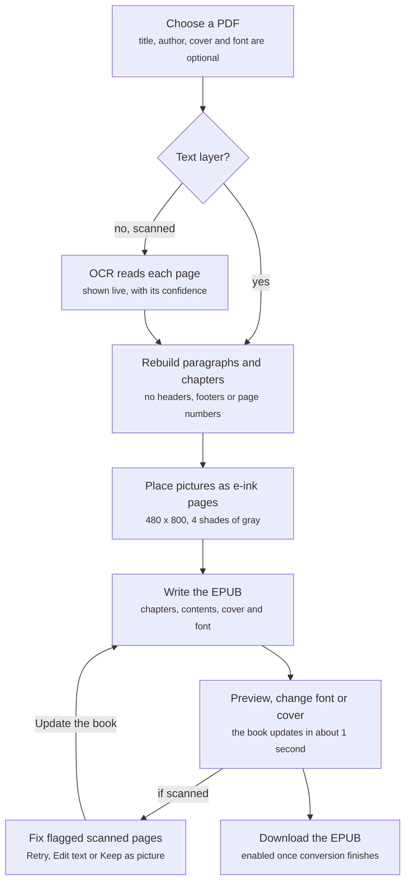

# convertPdf — Business Requirements Document

Date: 2026-10-19

## 1. Executive summary

convertPdf turns any PDF, including scanned books with no text layer, into a clean, readable EPUB e-book that runs entirely on the user's own computer.

PDFs are built for fixed-size printed pages. On a 6-inch e-reader they force zooming and panning, keep running headers and page numbers in the text, and break sentences across pages. Scanned books are worse: they are only pictures of text, so they cannot be reflowed, searched or resized at all.

convertPdf solves this by rebuilding real paragraphs and chapters, reading scanned pages with built-in OCR (English and Indonesian), and keeping pictures as full-screen pages tuned for 4-shade e-ink screens (480 x 800, Xteink/XTC format). It ships as a local web app, a command-line tool and a no-install Windows executable (`ConvertPdf.exe`, about 60 MB zipped). No file is ever uploaded to a server.

## 2. Business objectives and success criteria

The product succeeds when a non-technical reader can turn a PDF into an e-book that reads like a commercial EPUB, in minutes, without installing anything or sending the file anywhere.

| # | Objective | Success criterion |
| --- | --- | --- |
| BO-1 | Make PDFs readable on e-readers | Output is a reflowable EPUB with real paragraphs, no running headers, footers or page numbers, and sentences joined across pages |
| BO-2 | Unlock scanned books | Pages with no text layer are read by OCR with no extra install; clean printed text needs only occasional letter fixes |
| BO-3 | Keep the book's structure | Chapters and section headings appear in the table of contents; pictures stay where they appear in the text |
| BO-4 | Look right on 4-shade e-ink | Every picture, the cover and pages kept as pictures fill a 480 x 800 page in 4 dithered shades of gray |
| BO-5 | Protect the user's files | 100% of processing happens locally; no network upload of any file |
| BO-6 | Zero-friction access | A Windows user goes from download to first conversion by unzipping and double-clicking, without Node.js |
| BO-7 | Fast turnaround | A normal PDF converts in a few seconds; a 244-page scanned book with OCR in about 2 minutes on a 12-thread computer |
| BO-8 | Let users fix what OCR gets wrong | Low-confidence pages can be retried, hand-corrected or kept as a picture, and the book rebuilt in under a minute |

## 3. Scope

Version 1.0 covers one-way conversion of a single PDF into a single EPUB, on the user's own machine.

**In scope**

- Input: digital PDFs, scanned PDFs with a text layer, and scanned PDFs without one (up to 300 MB per upload in the web app)
- Output: EPUB with chapters, table of contents, title, author, cover and embedded pictures
- OCR for English and Indonesian, with automatic language detection
- Font choice: the reader's own font or one of 5 embedded open-source fonts
- Custom cover: the user's own picture can replace the cover found in the PDF
- Three delivery channels: local web app, command-line tool, Windows executable
- In-app preview, live OCR page review, retry, manual text entry and keep-as-picture

**Out of scope**

- Cloud hosting, user accounts or any server-side storage beyond the running session
- Output formats other than EPUB (MOBI, AZW3, PDF re-flow, native XTC files)
- Faithful layout of multi-column pages and tables (they come out as plain paragraphs)
- OCR languages beyond English and Indonesian in the shipped build
- Batch conversion of many PDFs at once
- Signed or prebuilt executables for macOS and Linux

## 4. Stakeholders and users

The primary user is an e-ink reader who owns PDFs, often scanned, and wants them as proper e-books without technical setup.

| Stakeholder / persona | Need | Channel they use |
| --- | --- | --- |
| E-ink reader (primary) | Read PDFs and scanned books comfortably on a small 4-shade screen | Windows exe or web app |
| Indonesian-language reader | Convert scanned Indonesian books, not only English ones | Web app with OCR |
| Privacy-conscious user | Convert personal or confidential documents without uploading them | Any; all are local |
| Power user / developer | Script conversions, choose OCR language, change the code | Command line, source install |
| Sharer | Hand a working converter to friends who have no Node.js | `ConvertPdf.exe` zip from GitHub Releases |
| Maintainer / product owner | Keep the converter accurate, small and easy to update | GitHub repository |

## 5. Current and future process

Today, readers either pan and zoom fixed PDF pages on a small screen, or upload files to online converters that keep headers and page numbers, cannot read scans, and take their documents off the machine.

With convertPdf, one local flow handles both kinds of PDF and ends in a previewed, e-ink-ready EPUB:

Pages without a text layer go through OCR first; after conversion the user can fix flagged pages and rebuild the book without reading the other pages again.

## 6. Functional requirements

26 requirements, 13 of them Must, define what version 1.0 delivers; priorities use MoSCoW.

| ID | Area | Requirement | Priority |
| --- | --- | --- | --- |
| FR-01 | Input | Accept a PDF by file picker or drag-and-drop (web app) or by file path (command line) | Must |
| FR-02 | Input | Refuse uploads over 300 MB with a clear message | Should |
| FR-03 | Input | Accept an optional title and author; when blank, take them from the PDF | Must |
| FR-04 | Text | Rebuild real paragraphs and join sentences that break across pages | Must |
| FR-05 | Text | Remove running headers, footers and page numbers | Must |
| FR-06 | Structure | Split the book into chapters by heading size (on scans, by where text starts low under a title); fall back to 10-page chapters; list section headings in the table of contents | Must |
| FR-07 | Pictures | Find, crop and place photos, charts and diagrams where they appear in the text | Must |
| FR-08 | Pictures | Use a picture-only first page as the cover | Should |
| FR-09 | Pictures | Show each picture, the cover and pages kept as pictures on a full 480 x 800 page in 4 dithered shades of gray | Must |
| FR-10 | OCR | Detect pages that are only pictures of text and read them with built-in OCR, nothing extra to install | Must |
| FR-11 | OCR | Detect English or Indonesian from 3 sample pages; let the command line set it with `--ocr-lang` | Must |
| FR-12 | OCR | Leave out lines read below 50% confidence and paragraphs read much worse than the rest of the book; show them as pictures instead | Should |
| FR-13 | OCR review | Show each scanned page live as it is read: the scan, the text and its confidence; mark pages at 75% or lower | Should |
| FR-14 | OCR review | Retry a page with other settings (higher resolution, black and white, one block) and keep the better reading | Should |
| FR-15 | OCR review | Let the user correct or type a page's text beside the scan (up to 1 MB per page) | Should |
| FR-16 | OCR review | Let pages read at 90% or lower be kept as a picture, with Use text to undo; filter to only those pages | Should |
| FR-17 | OCR review | Rebuild the book with the changed pages only, in under a minute | Should |
| FR-18 | Fonts | Offer the e-reader's font or 5 embedded fonts; switching font updates the book in about 1 second without converting again | Must |
| FR-19 | Preview | Preview the book in the browser with Prev / Next, arrow keys and a chapter list | Should |
| FR-20 | Progress | Show a progress bar with the current step, page count and time left | Should |
| FR-21 | Download | Enable Download only once conversion has finished | Must |
| FR-22 | Session | Keep the last 5 converted books in memory for quick font changes | Could |
| FR-23 | Command line | Convert with `node index.js input.pdf [output.epub]` and options for title, author, font and OCR language | Must |
| FR-24 | Distribution | Ship one Windows exe that unpacks itself, starts the server, opens the browser, picks the next free port and reopens the browser if run again | Must |
| FR-25 | Distribution | Let the port be set with the `PORT` environment variable | Could |
| FR-26 | Cover | Let the user choose a picture (JPEG, PNG or WebP, up to 20 MB; `--cover` on the command line) to replace the PDF's cover, shown in 4 shades of gray at 480 x 800; change or remove it without converting again | Should |

## 7. Non-functional requirements

Privacy and a no-setup install matter as much as conversion quality: the product must never send a file off the machine.

| ID | Category | Requirement |
| --- | --- | --- |
| NFR-01 | Privacy | All conversion, OCR and preview run locally; the server listens on localhost only and stores no file on disk |
| NFR-02 | Performance | Normal PDFs convert in a few seconds; a 540-page scanned book with 56 pictures in about 2 minutes |
| NFR-03 | Performance | OCR runs at about 0.5 s per page on a 12-thread computer, using up to 8 CPU cores |
| NFR-04 | Resources | OCR uses about 150 MB of memory per core; rendered pages waiting for OCR are capped so memory stays bounded on long books |
| NFR-05 | Startup | The exe unpacks about 64 MB to `%LOCALAPPDATA%\ConvertPdf` in about 2 s on first run, starts in under 1 s after that, and replaces old files when a newer exe runs |
| NFR-06 | Size | Download stays near 60 MB zipped (about 120 MB unzipped); each embedded font adds about 100 KB to a book |
| NFR-07 | Platform | Source install runs on Windows, macOS and Linux (x64, arm64) with Node.js 22.13 or newer; the exe targets Windows x64 |
| NFR-08 | Compatibility | Output is a standard EPUB that opens in common e-readers; embedded fonts look the same in each |
| NFR-09 | Usability | Plain-language progress, for example "Reading scanned pages: 57 of 244", with time left |
| NFR-10 | Licensing | Bundled fonts are under the SIL Open Font License; dependencies are open source |
| NFR-11 | Extensibility | A new OCR language is added by installing its Tesseract data and one entry in `LANGUAGES` in `ocr.js` |

## 8. Assumptions, constraints and dependencies

The product assumes a single user on one computer, converting one book at a time, with a modern browser.

**Assumptions**

- Users read on e-ink devices that accept EPUB, and many use 480 x 800, 4-shade screens such as Xteink
- Most scanned books users convert are printed English or Indonesian text
- Users can wait about 2 minutes for a scanned book and will review only flagged pages
- One user per running server; the 5-book cache is enough for font switching

**Constraints**

- Web app only: converted books live in memory and are lost when the server restarts
- The exe is not code-signed, so Windows SmartScreen and some antivirus tools warn on first run
- The exe runs only on the platform it was built on (Windows x64); other platforms need a source install
- If ports 3000 to 3010 are all busy, the app cannot start
- No automated test suite exists yet (`npm test` is a placeholder)

**Dependencies**

| Dependency | Used for |
| --- | --- |
| `pdfjs-dist` 6.x | Reading PDF text, layout and metadata (needs Node.js 22.13+) |
| `@napi-rs/canvas` | Rendering pages for pictures, the cover and OCR |
| `tesseract.js` 7.x + `@tesseract.js-data/eng`, `/ind` | Built-in OCR |
| `jszip` | Writing the EPUB container |
| `epubjs` | In-browser book preview |
| `@fontsource/*` | The 5 embeddable fonts |
| `postject` (dev) | Packing the app into a single Windows exe |
| GitHub Releases | Hosting the `ConvertPdf.zip` download |

## 9. Risks and mitigations

The largest risk is OCR quality on hard pages; the review tools exist to contain it.

| Risk | Impact | Mitigation |
| --- | --- | --- |
| OCR misreads handwriting, decorative lettering or poor scans | Wrong or garbled text in the book | Drop low-confidence lines and paragraphs; show them as pictures; Retry, Edit text and Keep as picture |
| Chapter titles cannot be read or found | Poor table of contents | Detect chapter starts by page layout; fall back to 10-page chapters |
| Multi-column pages and tables lose their layout | Hard-to-read passages | Documented limitation; Keep as picture for scanned pages |
| SmartScreen or antivirus blocks the unsigned exe | Users give up before first run | README steps (More info, Run anyway); code signing as a future option |
| Large scanned books exhaust memory on small machines | Slow or failed conversion | Cap at 8 cores, bound pages waiting for OCR, 300 MB upload limit |
| Server restart loses converted books | User must convert again | Download promptly; documented in README |
| Upstream library changes (pdf.js needs Node 22.13+) | Install or build failures | Pinned versions in `package-lock.json`; Node version stated in README |
| No automated tests | Regressions slip into releases | Add a regression suite of sample PDFs (open question) |

## 10. Open questions and glossary

**Open questions**

- [ ] Should the product also export native XTC/XTCH files for Xteink devices, beyond EPUB with e-ink-ready pages?
- [ ] Which OCR languages come next after English and Indonesian?
- [ ] Is code signing the Windows exe worth the yearly certificate cost?
- [ ] Should macOS and Linux builds be published on GitHub Releases?
- [ ] Is batch conversion of a folder of PDFs needed?
- [ ] What sample PDFs and pass criteria make up a regression test suite?
- [ ] Should converted books survive a server restart (saved to disk), at the cost of writing files locally?

**Glossary**

| Term | Meaning |
| --- | --- |
| EPUB | Open e-book format with reflowable text, read by most e-readers |
| OCR | Optical character recognition: reading text from a picture of a page |
| Text layer | Hidden, selectable text inside a PDF; scans often lack one |
| Confidence | OCR's own score (0 to 100%) of how sure it is of a reading |
| E-ink | Paper-like screen showing a few shades of gray, here 4 |
| Dithering | Mixing dots of the 4 grays to suggest smoother shading |
| XTC / Xteink | E-reader format and device family with 480 x 800 pages |
| MoSCoW | Priority scale: Must, Should, Could, Won't |
